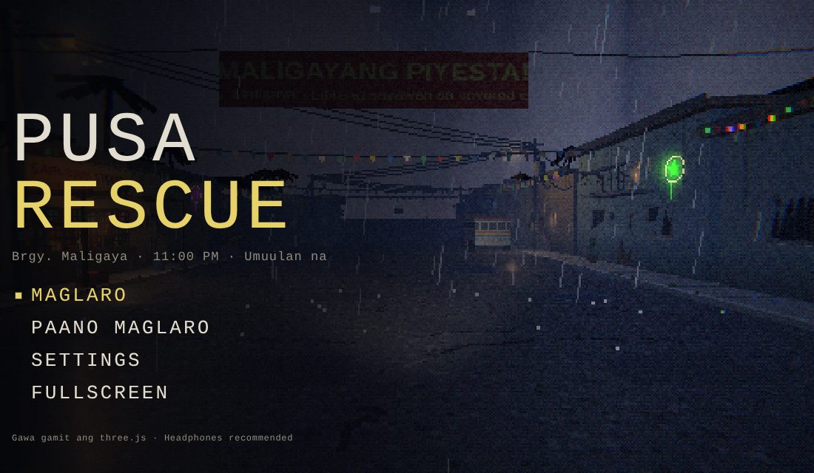
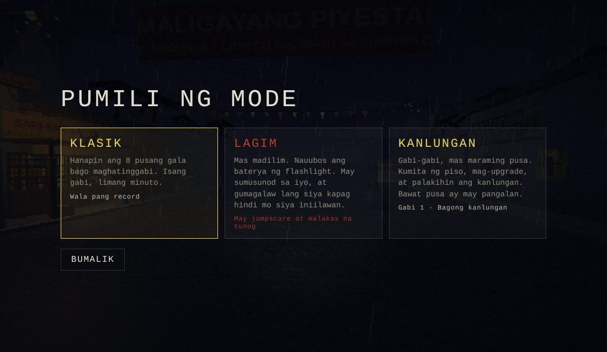
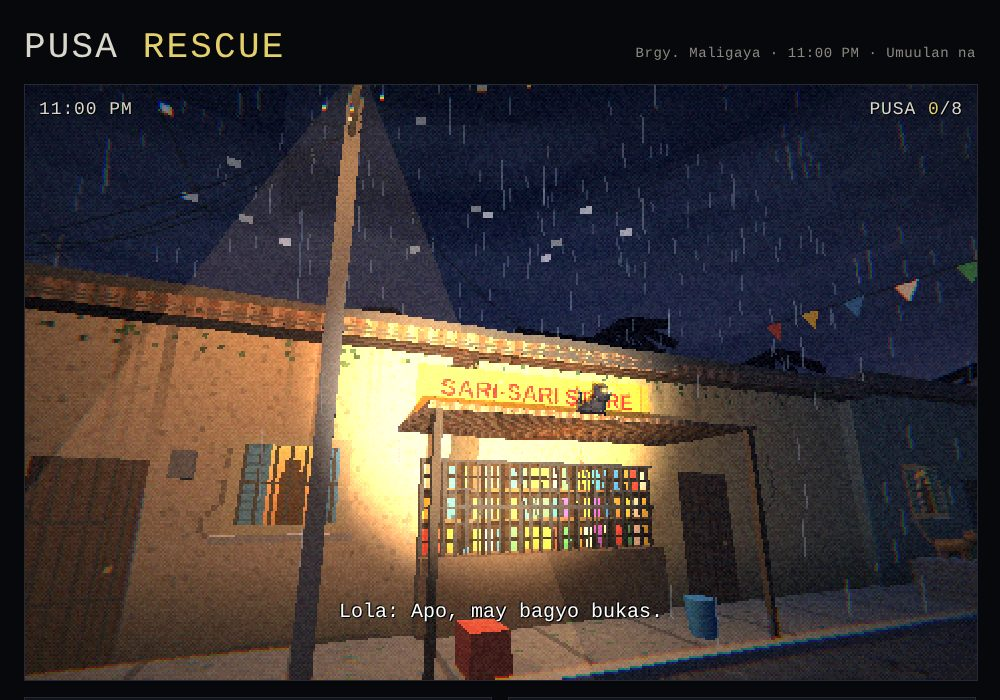
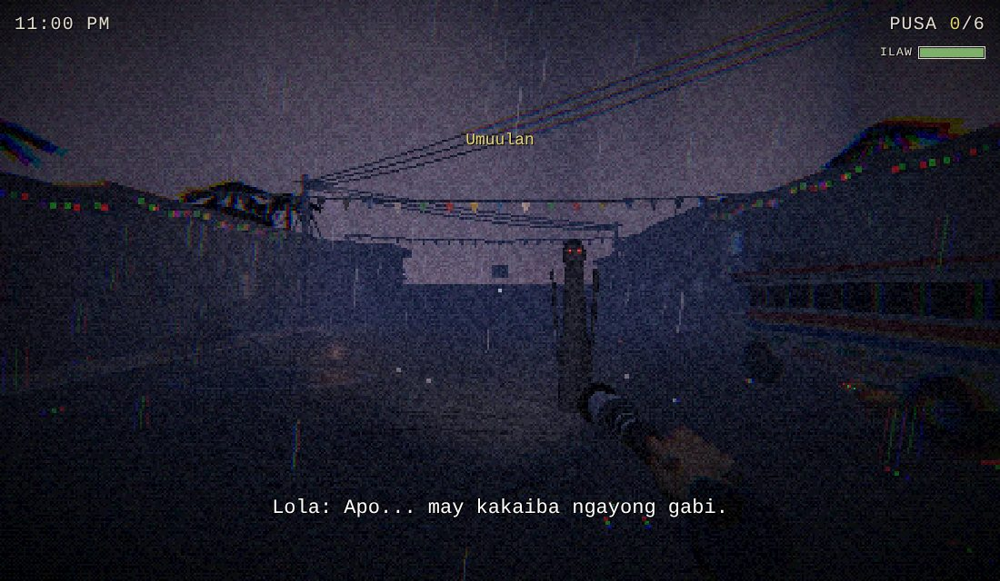
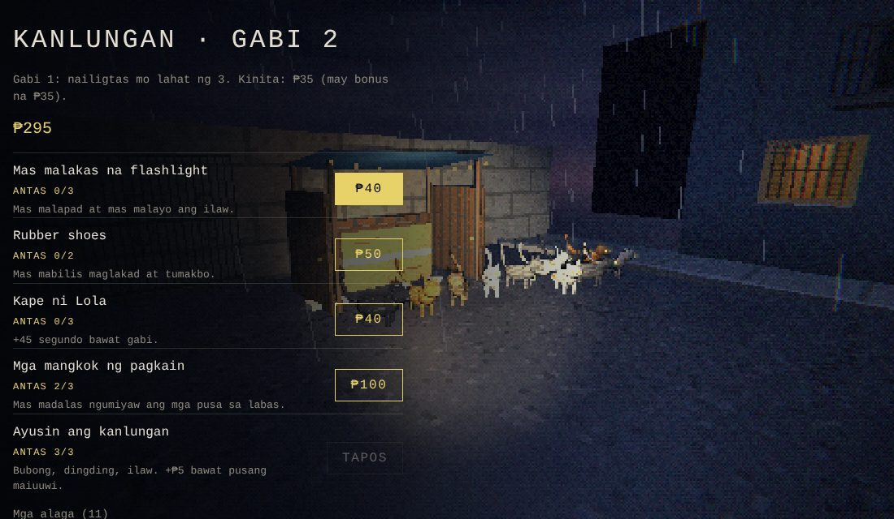
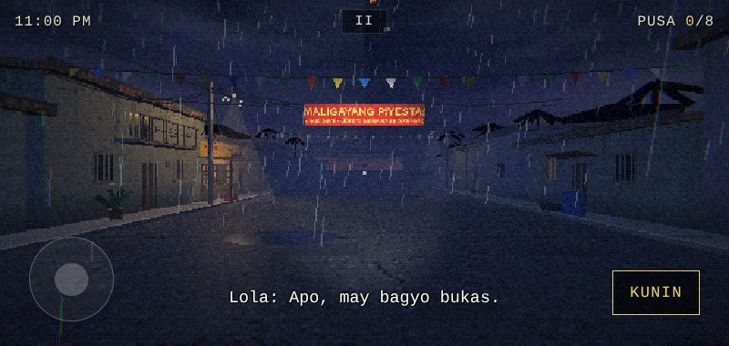
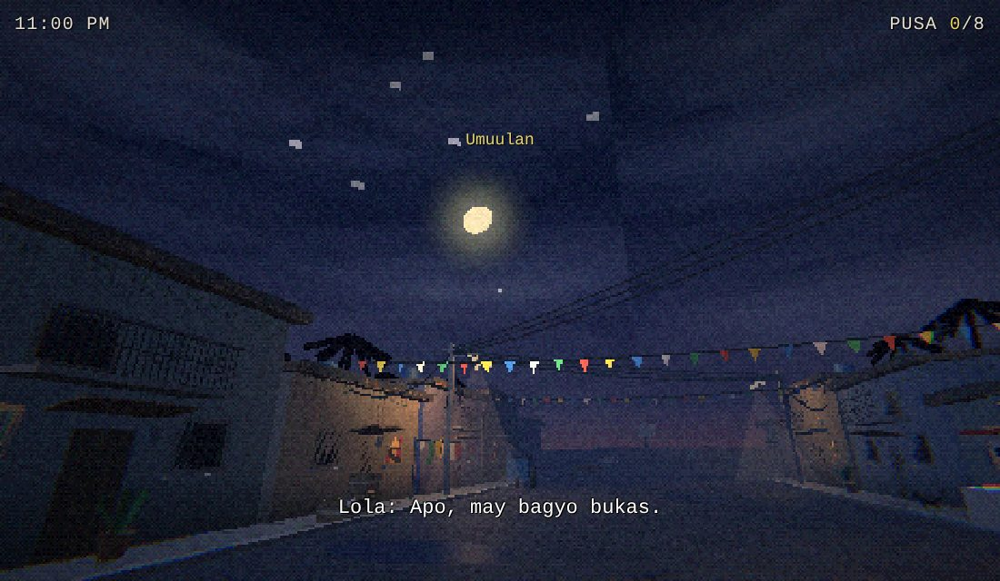
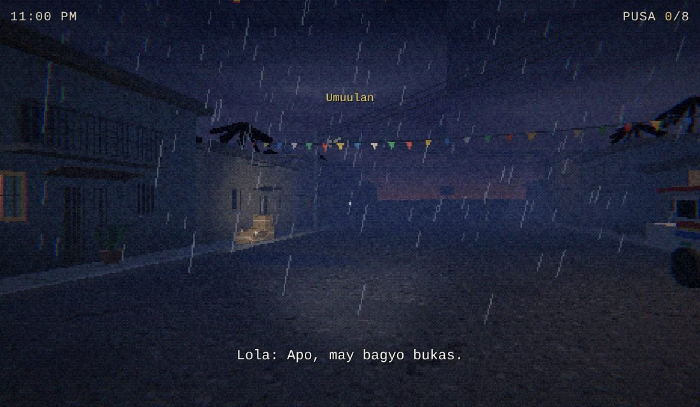
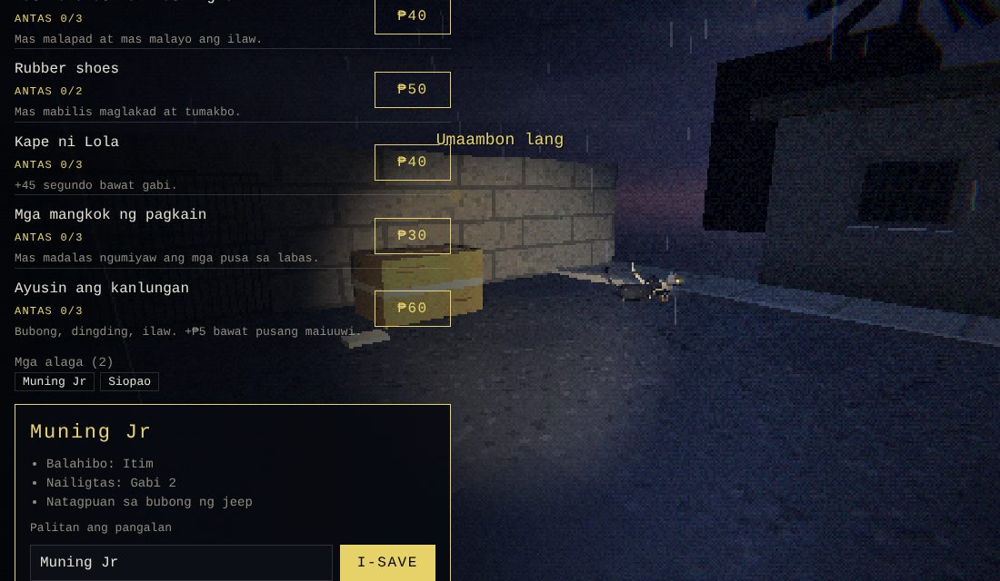
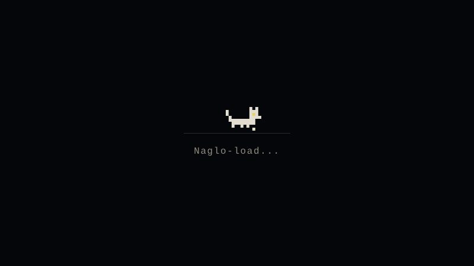

# Pusa Rescue

[](https://github.com/justinellarioza-specto/pusa-rescue/actions/workflows/check.yml)

A first-person, PS1-style night game set in a rainy Filipino barangay. A storm is coming, and Lola needs you to find the stray cats hiding around the street and bring them home to her shelter box before midnight.

**▶ Play it here: https://justinellarioza-specto.github.io/pusa-rescue/**



## Modes

| Mode          | What it is                                                                                                                                               |
| ------------- | -------------------------------------------------------------------------------------------------------------------------------------------------------- |
| **Klasik**    | Find 8 stray cats in 5 minutes. Your fastest time is saved.                                                                                              |
| **Lagim**     | Horror. Darker streets, a draining flashlight battery, and something that follows you. It only moves when your light is not on it. Contains a jumpscare. |
| **Kanlungan** | Build-up. Every night brings more cats. Each cat you rescue gets a name and lives at the shelter. Earn pesos to buy upgrades and build the shelter up.   |



## Features

- **Random weather every night:** steady rain, a storm with frequent lightning, light drizzle, or a clear night with the moon out
- **Difficulty:** Madali (more time, more meows), Normal, or Mahirap (less time, a faster stalker)
- **Footsteps and puddles:** your steps splash and ripple when you walk through water
- **Cat cards:** in Kanlungan, tap a rescued cat to see its fur, the night you saved it and where you found it, and rename it
- **Photo mode:** pause, fly the camera anywhere and save a crisp pixel screenshot
- **Controller support:** Xbox and PlayStation controllers work in menus and in game
- **Accessibility:** subtitles on/off, reduce flashing and shaking, bigger HUD text
- **Loading screen** with a walking pixel cat, and a clear message if a device can't run WebGL

## Controls

|               | Computer                          | Phone                             | Controller                         |
| ------------- | --------------------------------- | --------------------------------- | ---------------------------------- |
| Walk          | `W A S D` (`Shift` to run)        | Left joystick                     | Left stick (click it or RT to run) |
| Look          | Mouse (click the game to lock it) | Drag the right side of the screen | Right stick                        |
| Pick up a cat | `E` or click                      | **KUNIN** button                  | A / ✕                              |
| Pause         | `Esc` or `P`                      | **II** button                     | Start / Options                    |

**Photo mode** (from the pause menu): `W A S D` to fly, `R` / `F` up and down, `Enter` to save a picture, `Esc` to go back. Press `F3` anytime for FPS and position.

Tips: cats' eyes shine when your flashlight hits them, and their meows come from the left or right, so headphones help.

## Screenshots

|                                                 |                                            |
| ----------------------------------------------- | ------------------------------------------ |
|    |        |
|  |    |
|      |             |
|            |  |

## How it's built

- Plain HTML, CSS and JavaScript ES modules, no build step
- [three.js r128](https://threejs.org/) for the 3D scene, bundled in `vendor/` and loaded through an import map (no CDN needed)
- Low-resolution rendering, PS1-style vertex snapping and an ordered-dither post-processing shader (GLSL) for the retro look
- Pixel textures, signs and sounds (meows, rain, thunder) are all generated in code with Canvas and the Web Audio API
- Settings and Kanlungan progress are saved in the browser with `localStorage`
- Game rules live in a pure module (`js/core/rules.js`) with unit tests; ESLint, Prettier and GitHub Actions check every push

## Project structure

```
pusa-rescue/
├── index.html              Page markup: menus, HUD, overlays
├── css/
│   ├── base.css            Colors, fonts, layout, buttons
│   ├── menus.css           Menus, settings, pause, results, shop, cat card
│   └── hud.css             HUD, touch controls, loading, photo mode, jumpscare
├── shaders/
│   ├── post.vert.glsl      Fullscreen pass vertex shader
│   ├── post.frag.glsl      Retro filter: color grade, grain, vignette, dither
│   └── ps1-snap.glsl       Vertex snapping injected into every material
├── js/
│   ├── boot.js             Plain script: WebGL check and friendly error messages
│   ├── main.js             Entry point, frame loop, F3 overlay
│   ├── config.js           Tuning numbers (speed, reach, graphics presets)
│   ├── game.js             Modes, round logic, stalker AI, results, photo mode
│   ├── input.js            Keyboard, mouse, touch and controller
│   ├── audio.js            Synthesized sound effects and ambience
│   ├── core/
│   │   ├── rules.js        Pure game rules (tested)
│   │   ├── storage.js      Settings, save data and best times
│   │   └── util.js         Random helpers
│   ├── data/
│   │   ├── cats.js         Hiding spots and cat names
│   │   ├── shop.js         Kanlungan upgrades and prices
│   │   ├── weather.js      Weather presets
│   │   └── text.js         All in-game dialogue and messages
│   ├── engine/             Renderer, materials, textures, quality, shader loader
│   ├── world/              Street map, cats, shelter, Lagim props, weather and rain
│   └── ui/                 Screens and subtitles, menu buttons, shop and cat cards
├── tests/                  Unit tests (node:test)
├── vendor/                 three.js r128 and its license
└── .github/workflows/      GitHub Actions: lint, format check, tests
```

## Run it locally

The game uses ES modules and loads shader files, so it needs a local web server (opening `index.html` directly won't work). From the project folder:

```bash
npx serve .
# or
python3 -m http.server 8000
```

Then open the address it prints (for example `http://localhost:8000`).

## Development

Needs [Node.js](https://nodejs.org/) 20 or newer (only for the checks; the game itself has no build step).

```bash
npm install          # ESLint and Prettier
npm run lint         # find mistakes
npm run format       # auto-format JS, CSS, JSON and Markdown
npm test             # run the unit tests
```

GitHub Actions runs lint, the format check and the tests on every push.

## Credits

Made by [@justinellarioza-specto](https://github.com/justinellarioza-specto).
